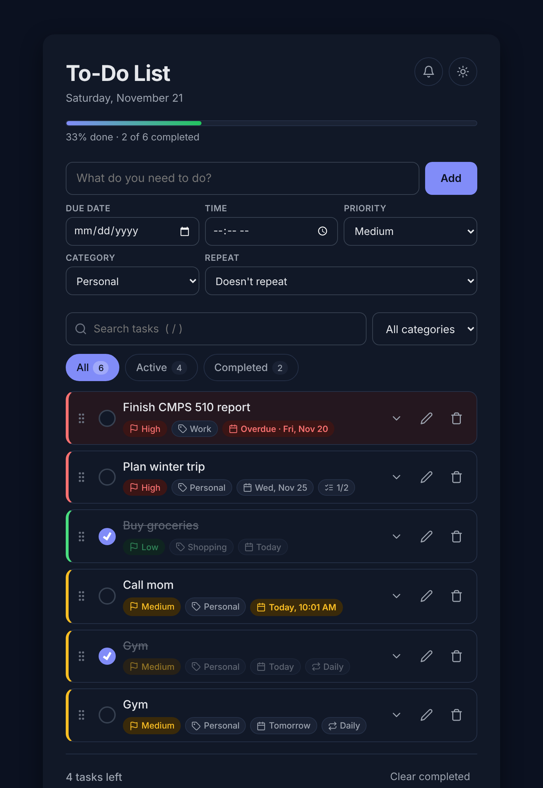

# To-Do List

A to-do list web app built with plain HTML, CSS and JavaScript for the **CMPS 510 final project** (Project 1: To-Do List).

**Live app:** https://laxmikanthrm.github.io/laxmikanth-project/

## Features

### Must-have (from the project catalogue)
- **Add a task**: type it and press Enter or click Add.
- **Tick a task as done** and **delete it**.
- **Tasks stay after the page is refreshed**: everything is saved in the browser's `localStorage`.

### Optional extra
- **Filters**: All, Active and Completed, each with a count, plus a **Clear completed** button.

### More features
- **Edit in place**: double-click a task (or click the pencil). Enter saves, Esc cancels.
- **Undo** after deleting a task, clearing completed tasks or importing (or press Ctrl+Z).
- **Due dates and times**: tasks show **Overdue** in red and **Today** in orange.
- **Priority** (High, Medium, Low), shown as a coloured stripe and badge.
- **Categories**: Work, Personal, Shopping, Other, with a category filter.
- **Search** across tasks and their subtasks.
- **Drag and drop to reorder**: drag the ⋮⋮ handle with a mouse or a finger. With the keyboard, focus the handle and press ↑ or ↓.
- **Subtasks / checklists** inside a task (open a task with the ˅ button).
- **Repeating tasks** (daily, weekly, monthly): ticking one creates the next one.
- **Reminders**: click the bell to allow notifications. You're reminded when a task with a time is due, as long as the page is open.
- **Task counter** ("3 tasks left") and a **progress bar** ("60% done").
- **Export and import** as JSON or CSV.
- **Dark mode** toggle (remembered; it follows your device setting the first time).
- **Keyboard shortcuts**: Enter to add, Esc to cancel, `/` to search, `N` for a new task.
- **Works on phones**: responsive layout with large tap targets.
- Friendly **empty state** ("Nothing to do 🎉") and small animations.

### Not included
- **Sync across devices** needs a login and a server. The project rules say "No server, database or sign-in", so tasks are saved only in the browser you use. Export and import can be used to move tasks to another device.

## How to run locally
Download the files and open `index.html` in any web browser. No installation or server is needed.

## Files
| File | Purpose |
|------|---------|
| `index.html` | Page structure |
| `style.css` | Layout, colours, light and dark themes, animations, phone layout |
| `script.js` | App logic: tasks, saving, filters, search, drag and drop, reminders, export and import |
| `screenshot.png`, `screenshot-dark.png` | Screenshots for this README |

## How it works (short)
- All tasks are kept in one JavaScript array, `tasks`. Each task looks like `{ id, text, done, due, time, priority, category, repeat, subtasks }`.
- Every change updates the array, saves it to `localStorage` (`saveTasks()`) and redraws the list (`render()`).
- `render()` picks the tasks that match the current filter, category and search, then builds the list items with `textContent`, so typed text can never inject HTML.

## Dark mode

## Tools and AI assistants used
- **Visual Studio Code**, **Git**, **GitHub** and **GitHub Pages** (hosting)
- **Inter** font from Google Fonts
- Icons drawn in the style of the free **Lucide** icon set (inline SVG)
- **Playwright** for automatic browser testing
- **Claude (Anthropic) AI assistant** helped write and test the code. I reviewed the code and can explain how it works.
