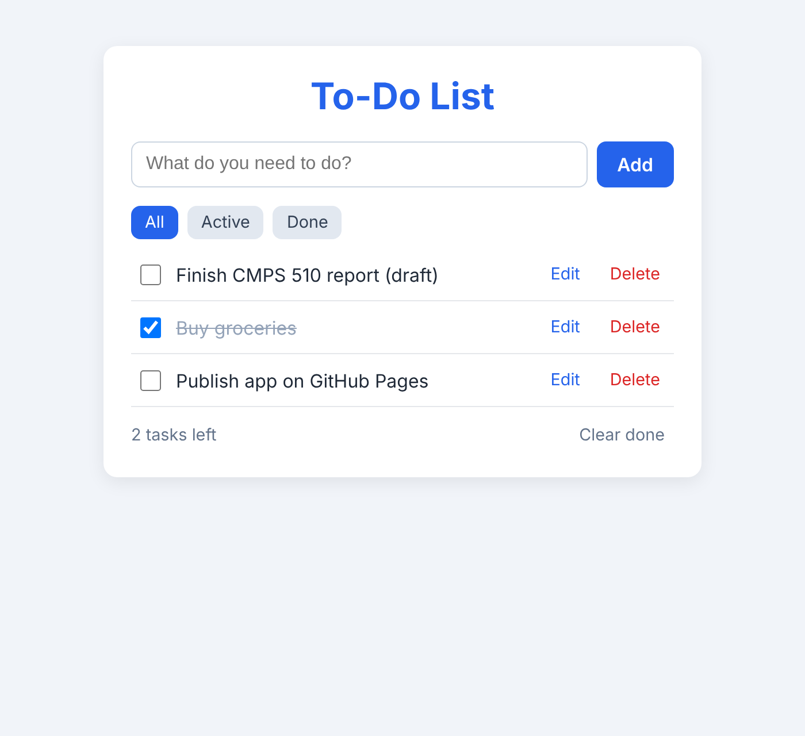

# To-Do List

A simple to-do list web app built with plain HTML, CSS and JavaScript for the CMPS 510 final project.

**Live app:** https://laxmikanthrm.github.io/laxmikanth-project/

## Features
- Add a task
- Tick a task as done
- Edit a task (Edit button or double-click)
- Delete a task, or clear all finished tasks at once
- Tasks stay after the page is refreshed (saved in the browser's `localStorage`)
- Optional extra: filter tasks by **All / Active / Done**

## Screenshot

## How to run locally
Open `index.html` in any web browser. No installation or server is needed.

## Files
| File | Purpose |
|------|---------|
| `index.html` | Page structure |
| `style.css` | Styling |
| `script.js` | App logic (add, toggle, delete, filter, save to localStorage) |

## Tools and AI assistants used
- Visual Studio Code / GitHub / GitHub Pages
- Claude (Anthropic) AI assistant was used to help write the first version of the code. I reviewed the code and can explain how it works.
